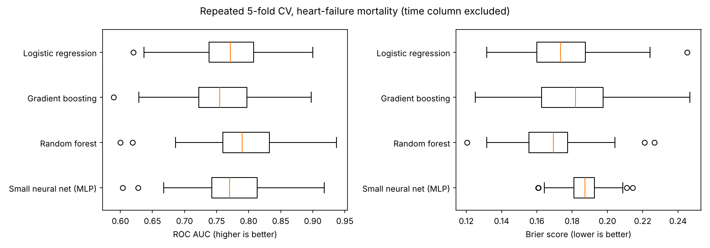
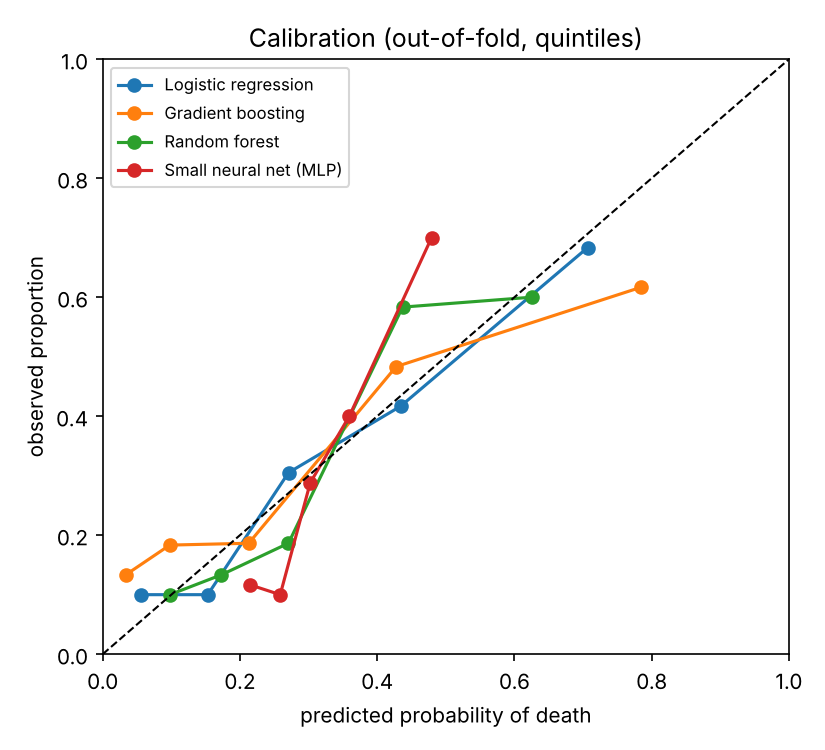
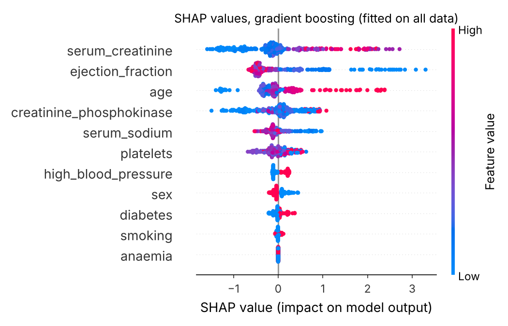
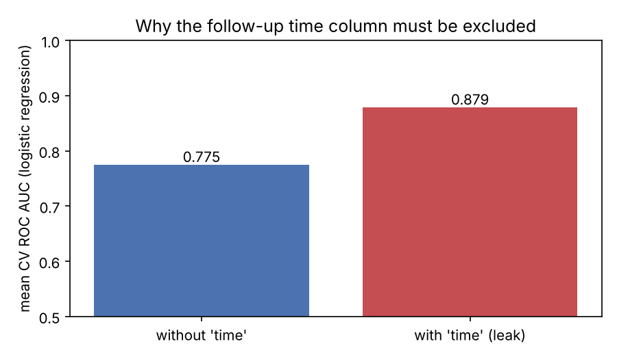

# Heart-failure mortality: do modern models beat logistic regression?

A small, carefully validated applied-ML study that goes beyond my theses: binary
outcome, tabular clinical data, classical versus modern models, with the focus on
calibration, interpretability and data leakage rather than a single headline score.

## Data

Heart Failure Clinical Records (Chicco & Jurman, *BMC Medical Informatics and
Decision Making* 20:16, 2020; UCI Machine Learning Repository #519, licence CC BY 4.0).
299 patients from Faisalabad, Pakistan (2015), 96 deaths during follow-up,
12 clinical features. The CSV is stored unchanged in `data/raw/` with a pinned
SHA-256 and is re-downloaded from UCI if missing.

**The `time` column (follow-up days) is excluded from every model.** Patients who
die have short follow-up by construction, so the column leaks the outcome. The
pipeline measures this leak explicitly (see below).

## Models and validation

* Logistic regression (log-transformed skewed labs, standardised)
* Histogram gradient boosting (shallow trees, L2 penalty)
* Random forest
* Small neural net (one hidden layer of 8 units; weight decay tuned by inner CV on log loss)

Validation is 20 × repeated stratified 5-fold CV. Reported metrics are ROC AUC,
PR AUC, Brier score, log loss, and the calibration slope and intercept.
SHAP values come from the boosting model.

## Headline results

From `results/summary.md` (regenerated automatically):

* All models are close: ROC AUC is **0.76–0.79**. Logistic regression (0.772)
  is as good as gradient boosting (0.759) and the neural net (0.773). Random
  forest is slightly ahead on discrimination (0.793) and Brier score (0.167).
* Calibration separates the models more than AUC does. Logistic regression is
  close to ideal (slope 0.89). Boosting is over-confident (slope 0.62). Random
  forest (1.33) and the regularised net (2.6) are too cautious, so their
  probabilities would need recalibration before clinical use.
* **Leakage:** adding `time` raises logistic-regression AUC from 0.775 to
  0.879. That number would look impressive and be meaningless at the point of care.
  (This check uses 10 repeats, so its clean AUC differs slightly from the table.)
* Serum creatinine and ejection fraction are the strongest predictors, which agrees
  with the original paper.






## Run it

```bash
pip install -r requirements.txt
python -m pytest -q
python src/run.py --quick    # ~20 s
python src/run.py            # full run (a few minutes)
```

## Limitations

* 299 patients from one centre, so intervals are wide and external validity is unknown.
* Death during follow-up of varying length is treated as a binary outcome; a
  survival model (as in `../survival-ml-pbc`) would be more appropriate and is a
  natural extension.
* SHAP values describe the fitted model, not causal effects.
