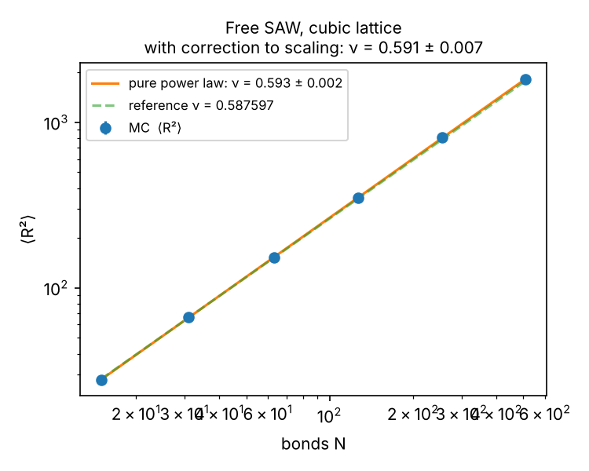
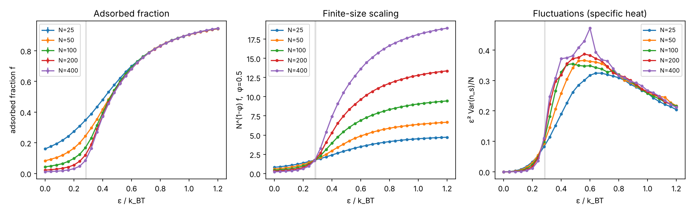

# polymc: dynamic Monte Carlo of polymer adsorption on a lattice

A tested, reproducible Python (numba) version of my Gdańsk MSc thesis:
self-avoiding polymer chains on the simple cubic lattice, first free in bulk to
validate the sampler, then grafted to an attractive wall to locate the adsorption
transition.

## Model

* Chain of N monomers on the simple cubic lattice, self-avoiding.
* **Free chain:** pivot moves (all 47 non-trivial cubic symmetries) and reptation
  (slithering snake).
* **Grafted chain:** monomer 0 fixed at (0, 0, 1) above an impenetrable wall at
  z = 0. Each monomer in the layer z = 1 gains energy −ε (units of k_BT).
  Moves are pivots (full cubic group plus the in-plane subgroup), crankshaft, kink
  and end moves, all with the Metropolis rule.
* **Replica exchange** (parallel tempering) over the whole ε grid, so strongly
  adsorbed replicas receive conformations rearranged at weaker attraction.
* **Convergence check:** every chain length is simulated from a fully desorbed
  start and from a fully adsorbed start. The maximum difference in the adsorbed
  fraction is reported, and half of it is added to the error bars.
* Error bars use Flyvbjerg–Petersen blocking to account for autocorrelation.

## Validation (tests in `tests/`)

* Exact enumeration of all short walks reproduces the known counts 6, 30, 150, 726.
* Monte Carlo averages match exact enumeration for free chains, for grafted chains
  at several ε, and for every replica of a replica-exchange run.
* Long chains stay connected, self-avoiding, above the wall and grafted after many moves.

## Results

Regenerated automatically into `results/`:

* **Flory exponent:** fitting ⟨R²⟩ ∝ N^{2ν}(1 + b N^{−0.528}) to N = 16–512 gives
  **ν = 0.591 ± 0.007**, consistent with the accepted 0.5876. A pure power law gives a
  biased 0.593 because of corrections to scaling.
* **Adsorption transition:** the curves N^{1−φ} f(ε) for N = 25–400 cross at
  **ε_c ≈ 0.282 k_BT** (pairwise crossings 0.277–0.287), consistent
  with literature values of about 0.28–0.29 for this model.
* In the adsorbed phase f(ε) becomes independent of N, and the fluctuation peak
  sharpens with N, as expected.
* Convergence: the two starts agree to within 0.02 in f for every N up to 400.




## What went wrong on the way (kept on purpose)

The first version used independent single-ε runs with pivot, kink and end moves
only. Above ε ≈ 0.4 the long chains never equilibrated. Adding replica exchange
helped, but the two-start check still showed differences of up to 0.3 in f.
The missing ingredient was the crankshaft move: without it, small surface
loops cannot form or disappear. With crankshaft moves the two starts agree to
about 0.02. The two-start check also showed that the pooled variance of the two
runs faked a large fluctuation peak, so within-run variances are used instead.
The two-start comparison is now part of every run.

## Run it

```bash
pip install -r requirements.txt
python -m pytest -q
python scripts/run_free_chain.py --quick   # seconds
python scripts/run_adsorption.py --quick   # seconds
python scripts/run_free_chain.py           # ~1 min
python scripts/run_adsorption.py           # ~30 min on 1 core (N up to 400, two starts)
```

## Limitations

* The crossover exponent is fixed at φ = 0.5 for the scaling plot; the ε_c
  estimate depends on this choice and on the modest chain lengths.
* Specialised methods such as PERM (Grassberger 2005) reach much longer chains and
  give more precise estimates of ε_c.

## References

* N. Clisby, *Accurate estimate of the critical exponent ν for self-avoiding walks
  via a fast implementation of the pivot algorithm*, PRL 104, 055702 (2010).
* P. Grassberger, *Simulations of grafted polymers in a good solvent*,
  J. Phys. A 38, 323 (2005).
* N. Madras & A. D. Sokal, *The pivot algorithm*, J. Stat. Phys. 50, 109 (1988).
