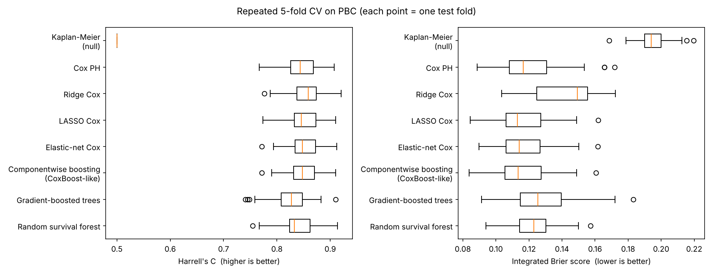
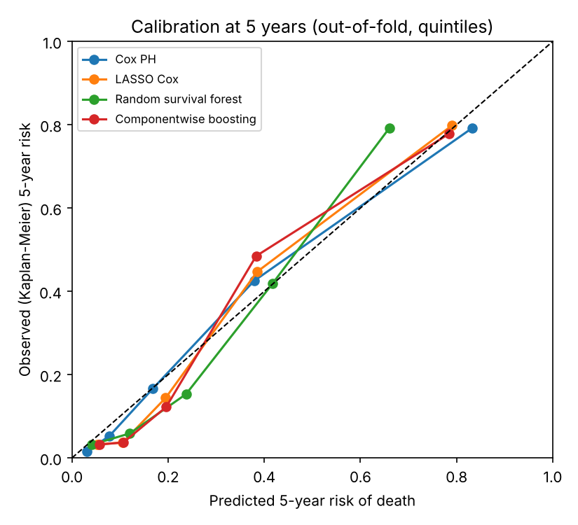

# Machine learning for the Cox model: a reproducible re-analysis of PBC

This project revisits my AIMS MSc thesis (*Machine Learning for the Cox Model*)
and fixes its main methodological weaknesses:

| Thesis | Here |
|---|---|
| one 80/20 split | 10 × repeated stratified 5-fold CV (50 test folds per model) |
| C-index only, no uncertainty | Harrell's C, Uno's C, integrated Brier score, 5-year AUC, with split-variability intervals |
| no proportional-hazards check | Schoenfeld-residual tests for every covariate |
| no calibration | 5-year calibration from out-of-fold predictions |
| CoxBoost described as tree-based | componentwise likelihood boosting (CoxBoost-like) **and** tree boosting, kept separate |
| hand-built tables | every table and figure written by code |

## Data

Mayo Clinic primary biliary cholangitis (PBC) trial, 1974–1984, as distributed
with the R package `survival` (Therneau & Grambsch, 2000). The raw file
`data/raw/pbc.rda` is unchanged from the package repository, with a pinned
SHA-256; `data/processed/pbc_trial.csv` is generated by `src/data.py`.

* **Analysis set:** the 312 randomised patients (125 deaths, 19 transplants).
* **Event:** death. Transplant is censored at the transplant time.
* **Features:** age, sex, ascites, hepatomegaly, spiders, oedema, stage,
  treatment arm, and 9 laboratory values; skewed labs are log-transformed.
  The few missing lab values (cholesterol 28, triglycerides 30, platelets 4,
  copper 2) are median-imputed **inside each training fold**.

## Headline results

From `results/summary.md` (regenerated automatically):

* A plain Cox model reaches a cross-validated **Harrell's C of 0.845**
  (integrated Brier score 0.121). The thesis value of 0.60 came from the
  evaluation setup, not the model.
* Penalised Cox models and componentwise boosting add about **+0.005 to +0.012**
  in C. Ridge has the highest C (0.857), but its survival curves are poorly
  calibrated (integrated Brier score 0.142, worse than plain Cox) because the
  penalty was tuned on concordance only.
* LASSO, elastic net and componentwise boosting give the best overall
  trade-off (C ≈ 0.85, integrated Brier score ≈ 0.117).
* Tree ensembles (random survival forest, boosted trees) do **not** beat Cox
  here. With 312 patients and largely log-linear effects this is expected.
* No covariate shows evidence against proportional hazards at the 5% level once
  skewed labs are log-transformed.




More figures: [LASSO path](results/figures/lasso_path.png), [Kaplan–Meier by stage](results/figures/km_by_stage.png).
Tables: [`cv_summary.csv`](results/cv_summary.csv), [`cox_hazard_ratios.csv`](results/cox_hazard_ratios.csv),
[`ph_test.csv`](results/ph_test.csv), per-fold scores in [`cv_scores_per_fold.csv`](results/cv_scores_per_fold.csv).

## Run it

```bash
pip install -r requirements.txt
python -m pytest -q          # data integrity + model sanity tests
python src/run.py --quick    # ~30 s smoke run
python src/run.py            # full run (~2 min on 2 cores)
```

## Limitations

* One dataset from a single 1970s–80s trial; results may not transfer.
* The intervals describe variability across random splits, not sampling
  uncertainty of a new population; fold estimates are correlated.
* Penalties are tuned for concordance; tuning on a likelihood or Brier score
  would likely fix Ridge's calibration.
* The full-data Cox fit is for interpretation only, and its in-sample C (0.865)
  is optimistic.

## Code

`src/data.py` loading and preparation · `src/models.py` model pipelines ·
`src/evaluate.py` fold metrics · `src/run.py` orchestration, tables, figures.
